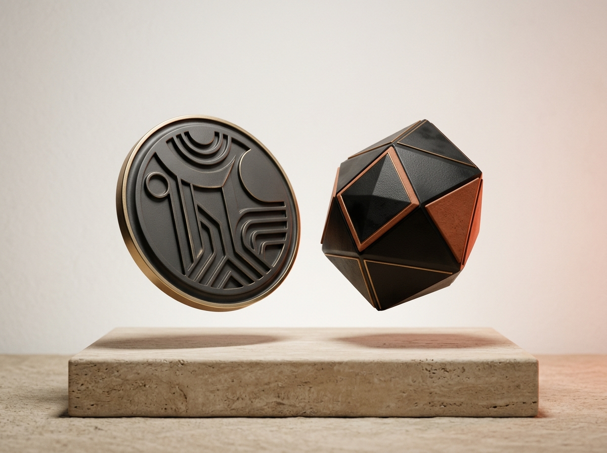
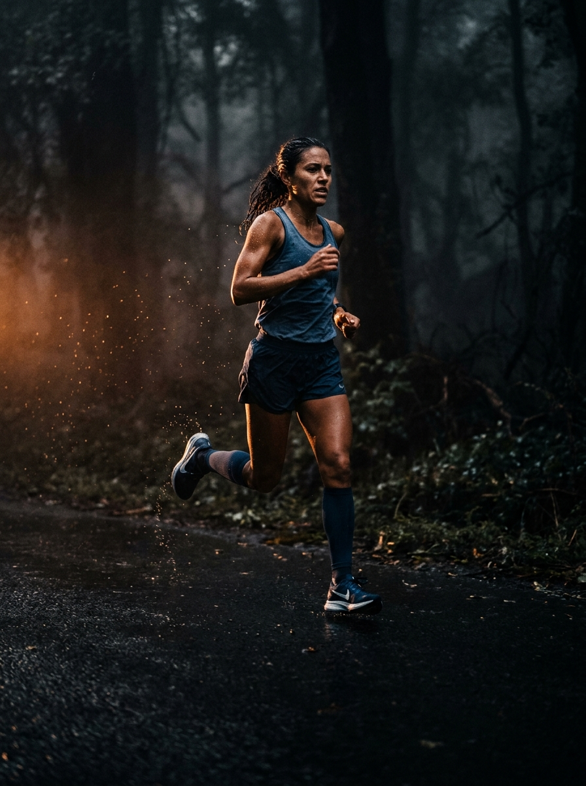
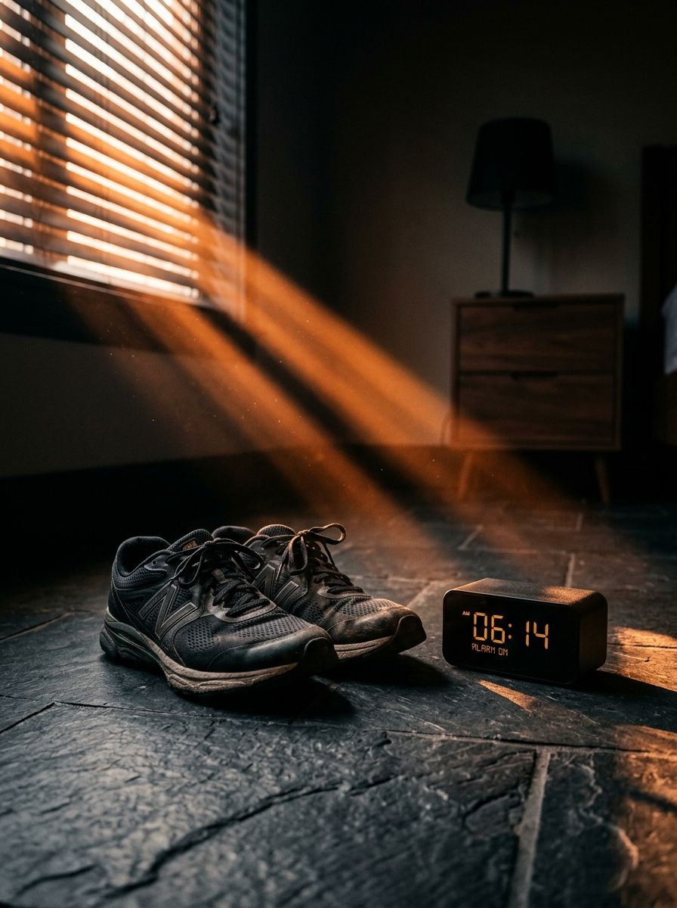
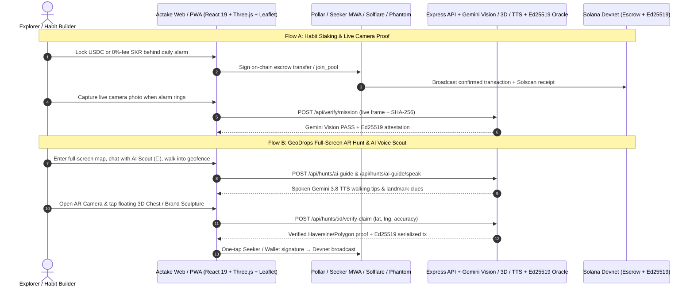

<div align="center">

<br />

<!-- Actake Brand Header -->
<h1>
  
</h1>

<h3>
  <strong>Put Real Skin in the Game. Beat the Alarm. Hunt Real-World 3D AR GeoDrops.</strong>
</h3>

<p>
  <em>A cross-platform Solana social accountability, AI-verified habit staking &amp; location-based 3D AR GeoDrops protocol powered by Anchor Escrow, Gemini Vision &amp; Voice AI, Three.js, Solana Mobile MWA, and Pollar.</em>
</p>

<p>
  <a href="https://actake.vercel.app">
    
  </a>
  <a href="https://solscan.io/account/ACTKescrow111111111111111111111111111111111?cluster=devnet">
    
  </a>
  <a href="https://explorer.solana.com/address/ACTKescrow111111111111111111111111111111111?cluster=devnet">
    
  </a>
  
  
</p>

<p>
  <a href="#-pitch-deck--why-actake"><strong>Pitch Deck</strong></a> ·
  <a href="#-geodrops-ar-scavenger-hunts--brand-ar-3d-studio"><strong>GeoDrops AR &amp; 3D Studio</strong></a> ·
  <a href="#-for-brands--communities--launch-ar-hunts--activations-on-actake"><strong>For Brands &amp; Communities</strong></a> ·
  <a href="#-solana-smart-contract--solscan-verification"><strong>Smart Contract</strong></a> ·
  <a href="#-visual-tour"><strong>Visual Tour</strong></a> ·
  <a href="#-quick-start--deployment"><strong>Quick Start</strong></a>
</p>

</div>

---

## 🎯 Pitch Deck — Why Actake?

### 1. The Problem: Traditional Habit Trackers & Passive Ads Are Built to Be Ignored

Every year, millions of people download habit trackers and alarm apps — and abandon them within 14 days. At the same time, brands spend billions on static digital banner ads that users scroll right past.

| Broken Mechanic | Why People Quit or Ignore It |
| :--- | :--- |
| **Zero Consequences** | Tapping *"Snooze"* or skipping a gym session costs $0. |
| **Honor-System Checkmarks** | Anyone can tap *"Done"* from bed while lying to themselves. |
| **Fake Photo Uploads** | Basic accountability apps let users upload old photos from their camera roll. |
| **Forgettable Banner Ads** | Traditional brand promotions generate zero real-world foot traffic or interactive engagement. |
| **High Crypto Friction** | Web3 dApps require browser extensions, manual RPC configuration, and confusing seed phrases before a user even takes their first action. |

---

### 2. The Solution: Programmable Accountability + Real-World 3D AR GeoDrops

**Actake turns everyday consistency and real-world exploration into an on-chain experience where showing up pays — and brands turn physical landmarks into interactive 3D AR treasure hunts.**

1. **💰 Stake Real Value Behind Your Habit** — Lock **SPL USDC** or **0%-fee Token-2022 SKR** into a non-custodial Solana escrow vault behind a daily alarm cutoff (e.g., *06:00 AM Morning Wakeup*, *07:00 AM Gym*, *09:00 PM Deep Study*).
2. **🔊 Non-Dismissible Loud Alarms** — When your deadline hits, Actake triggers a persistent Web Audio alarm (`Siren`, `Klaxon`, `Chime`, or `Pulse`) that refuses to quit until you prove you are awake and active.
3. **📸 Anti-Cheat Randomized Live Camera Challenge** — No static checklists. No gallery uploads. Our Gemini Vision Oracle generates a **brand-new randomized physical target** (avoiding your last 7–10 verified items) and requires a live camera capture verified in real time.
4. **🌍 Full-Screen GeoDrops AR Scavenger Hunts (`/hunts`)** — Map real-world circle or custom polygon geofences, explore edge-to-edge full-screen maps with a **talking AI Hunt Scout (`🤖`)**, walk into the zone with live GPS + magnetometer compass radar (or test from anywhere with **Indoor Demo Mode**), and tap floating 3D AR drops to unlock on-chain USDC/SKR rewards.
5. **🎨 Brand AR 3D Studio** — Brands and creators can drop classic 3D treasure chests, upload any 2D brand image rendered with **real sculpted 3D depth**, let **Gemini AI convert a 2D image into an interactive 3D sculpture**, or upload their own custom `.glb` 3D model.
6. **🔐 Stateless On-Chain Ed25519 Verification** — Both live camera proofs and GPS geofence unlocks are signed by Actake's Ed25519 Oracle and verified natively on Solana Devnet via `Ed25519Program`.

---

## 🌍 GeoDrops AR Scavenger Hunts & Brand AR 3D Studio

GeoDrops (`/hunts`) brings real-world augmented reality scavenger hunts to Solana Mobile and modern web browsers — without requiring any smart contract redeployment or unsolicited sensor prompts.

### Full-Screen Map-First Navigation & Voice AI Scout
- **Edge-to-Edge Full-Screen Map**: Entering any hunt immediately launches a clean, full-screen interactive Leaflet map displaying the highlighted geofence radius or custom multi-corner polygon area.
- **Instant Guide Pop-Up & Collapsed-by-Default HUD**: A crisp welcome pop-up explains the 2-step unlock flow and lets hunters choose **Enable AR & Sensor Mode** (live GPS + compass + rear camera), **Indoor Demo** (virtual walk & compass sliders for desktop/indoor testing), or **Explore Map**. Every write-up, lore card, map hint, and demo slider stays neatly collapsed until tapped.
- **Conversational Talking AI Hunt Scout (`🤖`)**: Tap the floating `🤖` button on any map, radar, or AR screen to converse by text or voice with an AI navigator powered by **Gemini 4 Hydrogen** and **Gemini 3.8 Flash Lite TTS**. It reads your live distance, heading, and landmark clues to talk you right into the geofence with spoken audio tips.
- **Strict Opt-In Hardware Gate**: Camera, high-accuracy GPS (`useHighAccuracyGPS`), compass (`useCompassHeading`), and WebXR/Camera AR (`useARSession`) stay completely dormant until the user explicitly opts in via `isSensorActive`.

### Brand AR 3D Studio (4 Ways to Drop 3D Assets in AR)

| Asset Mode | How It Works | Ideal Use Case |
| :--- | :--- | :--- |
| **3D Treasure Chest** | Procedural 10-part PBR hinged chest with metallic lock, floating animation, and 36-coin burst on unlock. | Community hunts, campus drops, everyday token giveaways. |
| **3D Depth Brand Image** | Upload any PNG, JPG, or WebP logo or poster — Actake computes a real luminance/alpha height displacement + bump map inside a sculpted 3D `card`, `medallion`, or `cutout` casing with adjustable depth strength and accent glow. | Fast brand launches where you only have a 2D logo, mascot, or product visual. |
| **AI Image → 3D Sculpture** | Upload a 2D brand image and click **Convert Image to 3D with AI** — server-side **Gemini 4 Hydrogen** analyzes the visual and builds a multi-part PBR 3D monument with your brand emblem mounted in 3D on the hero face. | Eye-catching 3D sponsored monuments without hiring a 3D artist. |
| **Custom `.GLB` Upload** *(Optional)* | Upload your own binary glTF 2.0 (`.glb`, up to 10 MB, magic-byte validated on the server) — auto-centered, auto-scaled, and rendered with embedded animations via `GLTFLoader`. | Bespoke 3D mascots, sneakers, beverages, collectibles, and flagship brand models. |

---

## 📣 For Brands & Communities — Launch AR Hunts & Activations on Actake

**We invite brands, Web3 communities, event organizers, cafes, retail flagships, and campus clubs to host location-based AR listing hunts and interactive 3D advertisements on Actake.**

Instead of paying for passive impressions that disappear in a feed, turn real-world locations into verifiable foot-traffic experiences powered by Actake's distinct 3D AR engine and transparent Solana escrow:

- **Turn Your Logo or Product Into a Floating 3D AR Drop in 60 Seconds**: Upload a 2D image for instant 3D depth embossing, convert it into a bespoke AI 3D sculpture, or drop your own `.glb` brand model directly inside **Create Hunt → Brand AR 3D Studio**.
- **Draw Exact Real-World Geofences**: Pin a storefront, conference booth, pop-up venue, or festival lawn with a `15m`, `25m`, or `50m` radius — or trace a custom multi-corner polygon boundary right on the map.
- **Verifiable On-Chain Proof of Presence**: Every reward claim requires real GPS proximity (`<= 25m` accuracy in live mode) verified by Actake's server-side Haversine + polygon gate and signed with an Ed25519 attestation on Solana Devnet.
- **Built-In Conversational AI Brand Concierge (`🤖`)**: Customize your hunt's landmark clue and lore — Actake's talking AI Hunt Scout weaves your brand context into spoken navigation tips that guide explorers straight to your drop.
- **Zero Friction for Attendees**: Explorers join public hunts for free and sign unlocks with **Pollar** (Email, Google, Passkey), **Solana Seeker Seed Vault (MWA)**, Phantom, Solflare, or an instant Devnet vault.

> **Ready to drop a sponsored GeoDrop or community campaign?** Open the live web app, head to **Hunts (`/hunts`)**, click **Create Hunt**, map your real-world location, customize your 3D brand drop in **Brand AR 3D Studio**, and fund your USDC or 0%-fee SKR prize pool directly on Solana Devnet.

---

### Protocol Economics & Token Matrix

| Asset | Token Standard | Protocol Fee (on Slashed Bonus) | ACT Points Multiplier | Missed Solo Stake Routing | Missed Squad Stake Routing |
| :--- | :--- | :---: | :---: | :--- | :--- |
| **USDC** | SPL Token (6 decimals) | **1.5%** | `1.0×` | 50% back to owner / 50% to Actake Fee Treasury | Split among verified Squad winners |
| **SKR** *(Seeker)* | Token-2022 (6 decimals) | **0.0% (Fee-Free)** | `1.2×` | 50% back to owner / 50% to Actake Fee Treasury | Split among verified Squad winners |

---

## 🔗 Solana Smart Contract & Solscan Verification

Actake's on-chain escrow logic lives in [`programs/actake_escrow/programs/actake_escrow/src/lib.rs`](./programs/actake_escrow/programs/actake_escrow/src/lib.rs) (Anchor `0.30.1`, Rust). All GeoDrops AR & Brand 3D Studio features work cleanly alongside the already-deployed contract with **zero smart contract modifications or redeployment required**.

### Deployed Program & On-Chain Addresses (Solana Devnet)

| Component | On-Chain Address / Program ID | Inspect on Solscan | Inspect on Solana Explorer |
| :--- | :--- | :---: | :---: |
| **Actake Escrow Contract (`actake_escrow`)** | `ACTKescrow111111111111111111111111111111111` | [](https://solscan.io/account/ACTKescrow111111111111111111111111111111111?cluster=devnet) | [](https://explorer.solana.com/address/ACTKescrow111111111111111111111111111111111?cluster=devnet) |
| **Native Ed25519 Signature Verify Program** | `Ed25519SigVerify111111111111111111111111111` | [](https://solscan.io/account/Ed25519SigVerify111111111111111111111111111?cluster=devnet) | [](https://explorer.solana.com/address/Ed25519SigVerify111111111111111111111111111?cluster=devnet) |
| **Solana Memo Program v2** *(Receipts)* | `MemoSq4gqABAXKb96qnH8TysNcWxMyWCqXgDLGmfcHr` | [](https://solscan.io/account/MemoSq4gqABAXKb96qnH8TysNcWxMyWCqXgDLGmfcHr?cluster=devnet) | [](https://explorer.solana.com/address/MemoSq4gqABAXKb96qnH8TysNcWxMyWCqXgDLGmfcHr?cluster=devnet) |
| **Devnet USDC Mint** *(SPL Token)* | `4zMMC9srt5Ri5X14GAgXhaHii3GnPAEERYPJgZJDncDU` | [](https://solscan.io/token/4zMMC9srt5Ri5X14GAgXhaHii3GnPAEERYPJgZJDncDU?cluster=devnet) | [](https://explorer.solana.com/address/4zMMC9srt5Ri5X14GAgXhaHii3GnPAEERYPJgZJDncDU?cluster=devnet) |
| **Seeker SKR Mint** *(Token-2022)* | `SKR1111111111111111111111111111111111111111` | [](https://solscan.io/token/SKR1111111111111111111111111111111111111111?cluster=devnet) | [](https://explorer.solana.com/address/SKR1111111111111111111111111111111111111111?cluster=devnet) |

> **💡 Custom Deployment Tip:** When you deploy your own instance of `programs/actake_escrow` via `anchor deploy --provider.cluster devnet`, set `VITE_ACTAKE_ESCROW_PROGRAM_ID=<YOUR_DEPLOYED_PROGRAM_ID>` in your environment variables. See [`programs/actake_escrow/DEPLOY_DEVNET.md`](./programs/actake_escrow/DEPLOY_DEVNET.md) for the 4-step deployment guide.

### Smart Contract Instructions (`actake_escrow`)

| Instruction | Access | Description |
| :--- | :--- | :--- |
| `create_pool` | Pool Creator | Initializes a commitment Pool PDA + Token Vault PDA supporting both SPL Token (`USDC`) and Token-2022 (`SKR`), configured with `oracle_pubkey`, `treasury`, `stake_amount`, `deadline_unix_ts`, and `protocol_fee_bps`. |
| `join_pool` | Any User | Locks the user's SPL/Token-2022 stake into the Pool Vault PDA via `transfer_checked` and initializes their Participant PDA with a 64-day check-in bitmap. |
| `submit_checkin` | Verified User | Uses Solana `sysvar::instructions` introspection to verify that the immediately preceding instruction is a valid native `Ed25519Program` attestation signed by `pool.oracle_pubkey` over `pool_pda \|\| user_pubkey \|\| day_index \|\| proof_hash`. |
| `settle_and_claim` | Verified Winner | Transfers the winner's principal + proportional slashed bonus directly from the Vault PDA and routes the protocol fee (1.5% USDC / 0% SKR) to the constrained `treasury_token_account`. |
| `sweep_to_treasury` | Permissionless *(Post-Deadline)* | Sweeps forfeited stakes from expired solo commitments or zero-winner pools directly from the Vault PDA into the Actake Fee Treasury. |

---

## 🖼️ Visual Tour

<div align="center">
  <table>
    <tr>
      <td align="center" width="50%">
        
        <br />
        <strong>GeoDrops Full-Screen Map &amp; Real-World AR</strong>
        <br />
        <sub>Full-screen geofence navigation, talking AI Scout (🤖), and floating 3D AR unlocks</sub>
      </td>
      <td align="center" width="50%">
        
        <br />
        <strong>Brand AR 3D Studio</strong>
        <br />
        <sub>Sculpted 3D depth brand emblems, AI Image-to-3D monuments &amp; custom .GLB drops</sub>
      </td>
    </tr>
  </table>
  <br />
  <table>
    <tr>
      <td align="center" width="25%">
        
        <br />
        <strong>Today Vault &amp; Balances</strong>
        <br />
        <sub>Live USDC/SOL toggle &amp; Quick Actions</sub>
      </td>
      <td align="center" width="25%">
        
        <br />
        <strong>Morning Consistency</strong>
        <br />
        <sub>06:00 AM stakes with loud alarms</sub>
      </td>
      <td align="center" width="25%">
        
        <br />
        <strong>Live AI Camera Proof</strong>
        <br />
        <sub>Randomized daily object verification</sub>
      </td>
      <td align="center" width="25%">
        
        <br />
        <strong>Streak Escrow &amp; Payouts</strong>
        <br />
        <sub>Claim principal + slashed bonus splits</sub>
      </td>
    </tr>
  </table>
</div>

### Ecosystem & Technology Partners

<div align="center">
  <table>
    <tr>
      <td align="center" width="20%">
        
        <br />
        <strong>Pollar</strong><br />
        <sub>Email, Passkey &amp; Fiat RAMP</sub>
      </td>
      <td align="center" width="20%">
        
        <br />
        <strong>Solana &amp; Seeker</strong><br />
        <sub>Seed Vault MWA &amp; SPL</sub>
      </td>
      <td align="center" width="20%">
        
        <br />
        <strong>Three.js &amp; Leaflet</strong><br />
        <sub>PBR 3D AR &amp; Geofences</sub>
      </td>
      <td align="center" width="20%">
        
        <br />
        <strong>Gemini AI</strong><br />
        <sub>Vision, AI-to-3D &amp; Voice TTS</sub>
      </td>
      <td align="center" width="20%">
        
        <br />
        <strong>Supabase</strong><br />
        <sub>Pools, Hunts &amp; Live Feeds</sub>
      </td>
    </tr>
  </table>
</div>

---

## 🏗️ Architecture & Verification Loop



---

## ✨ Core Features

- **🌍 Full-Screen GeoDrops AR Scavenger Hunts (`/hunts`)**
  - Edge-to-edge full-screen interactive map with dismissible welcome guide pop-up and collapsed-by-default write-ups, clues, and demo controls.
  - Real-world circle radius (`15m` / `25m` / `50m`) and custom multi-corner polygon geofence mapping.
  - Strictly opt-in `useHighAccuracyGPS`, `useCompassHeading`, and `useARSession` hooks (`isSensorActive` gate) + **Indoor Demo Mode** for desktop/indoor testing.
- **🤖 Conversational Talking AI Hunt Scout**
  - Floating `🤖` assistant right on the map, radar, and AR screens powered by **Gemini 4 Hydrogen** + **Gemini 3.8 Flash Lite TTS** with speech-to-text mic input, 1-tap hint prompts, and spoken voice guidance.
- **🎨 Brand AR 3D Studio**
  - Drop classic 3D chests, convert any 2D brand image into an extruded **3D Depth Image** (`card`, `medallion`, `cutout`), run **AI Image-to-3D Sculpture** synthesis, or upload an optional binary `.glb` 3D model with live interactive turntable preview.
- **🔐 Unified Cross-Platform Auth**
  - **Pollar Account** (Email, Google, Passkey + Fiat RAMP), **Solana Mobile Wallet Adapter (MWA) & Seeker Connect**, **Wallet Standard Extensions** (Phantom, Solflare, Backpack), and an instant **Browser Devnet Vault**.
- **💳 Live Today Vault & On-Chain Escrow/Treasury Monitors**
  - Real-time USDC/SOL balance toggle with 24h SOL fluctuation, collapsible Quick Actions, and live Escrow & Treasury wallet balance cards with Solscan links in Settings.
- **⏰ Non-Dismissible Alarms, Squads & Solana Blinks**
  - Persistent Web Audio alarms, randomized Gemini Vision live camera verification, Squad accountability pools, and shareable Solana Actions / Blinks (`/actions.json`).

---

## 🧰 Tech Stack

| Layer | Technologies |
| :--- | :--- |
| **Frontend & 3D AR** | React 19, TypeScript, Vite, Tailwind CSS v4, **Three.js** (`GLTFLoader`, `RoomEnvironment` PBR), **Leaflet** (OpenStreetMap geofences), Lucide Icons |
| **Solana & Wallets** | `@solana/web3.js`, `@solana-mobile/seeker-connect-wallet-standard`, `@solana-mobile/wallet-standard-mobile`, `@wallet-standard/app`, `@pollar/react`, Anchor `0.30.1` (Rust) |
| **Backend & Gemini AI** | Node.js, Express, `@google/genai` (**Gemini 4 Hydrogen** Vision/3D/Chat + **Gemini 3.8 Flash Lite TTS** Voice), Node `crypto` Ed25519 Oracle |
| **Database & Hosting** | Supabase PostgreSQL (`supabase/schema.sql`), Vercel |

---

## 🚀 Quick Start & Deployment

### 1. Clone & Install Dependencies

```bash
git clone <your-repo-url>
cd actake
npm install
```

### 2. Configure Environment Variables

Copy `.env.example` to `.env` (or configure in **Vercel → Project Settings → Environment Variables**):

| Variable | Scope | Required | Purpose |
| :--- | :---: | :---: | :--- |
| `GEMINI_API_KEY` | Server | **Yes** | Powers live camera vision oracle, Brand AI Image-to-3D synthesis, and the talking AI Hunt Scout (chat + TTS voice). |
| `VITE_POLLAR_API_KEY` | Client | **Recommended** | Publishable Pollar key (add your domain to Allowed Origins in Pollar Dashboard). |
| `ACTAKE_ESCROW_WALLET` / `VITE_ACTAKE_ESCROW_WALLET` | Server + Client | **Recommended** | Public Solana address holding active habit stakes & GeoDrop prize pools. |
| `ACTAKE_TREASURY_WALLET` / `VITE_ACTAKE_TREASURY_WALLET` | Server + Client | **Recommended** | Public Solana address receiving 1.5% USDC fees & 50% solo forfeits. |
| `GEODROP_ORACLE_SECRET_KEY` | Server | Optional | Persistent Ed25519 key for signing GeoDrop location claim attestations. |
| `VITE_ACTAKE_ESCROW_PROGRAM_ID` | Client | Optional | Deployed Solana Devnet Anchor Program ID (leave unset to route stakes directly into `ACTAKE_ESCROW_WALLET`). |
| `SOLANA_RPC_URL` | Server | Optional | Dedicated Solana RPC endpoint (defaults to `https://api.devnet.solana.com`). |
| `ORACLE_PRIVATE_KEY_HEX` | Server | Optional | Persistent 64-char hex Ed25519 seed for deterministic habit check-in attestations. |
| `SUPABASE_URL` & `SUPABASE_SERVICE_ROLE_KEY` | Server | Optional | Persistent PostgreSQL storage for pools, `geo_hunts`, participants & check-ins (`supabase/schema.sql`). |
| `APP_URL` | Server | Optional | Production origin (e.g. `https://actake.vercel.app`) for Solana Blinks & invite links. |

### 3. Run Locally & Build

```bash
npm run dev      # Unified Express + Vite server on http://localhost:3000
npm run lint     # TypeScript strict check
npm run build    # Production bundle
```

---

## 📡 Backend API Reference

| Method | Endpoint | Description |
| :---: | :--- | :--- |
| `GET` | `/api/health` | Server health check & oracle public key status. |
| `GET / POST` | `/api/hunts` | Lists public GeoDrops hunts or publishes a new funded geofenced hunt (with optional Brand AR 3D asset). |
| `POST` | `/api/hunts/:id/join` | Registers a hunter wallet into a public GeoDrop hunt. |
| `POST` | `/api/hunts/:id/verify-claim` | Verifies Haversine / polygon geofence proximity + GPS accuracy (`<= 25m`) and returns an Ed25519 Oracle-attested claim transaction. |
| `POST` | `/api/hunts/:id/confirm-claim` | Records a confirmed Devnet unlock receipt and updates remaining drops. |
| `POST` | `/api/hunts/ai-to-3d` | Server-side Gemini 4 Hydrogen conversion of an uploaded 2D brand image into a structured 3D PBR sculpture blueprint. |
| `POST` | `/api/hunts/ai-guide` | Context-aware conversational AI Hunt Scout returning concise directional tips and landmark clues. |
| `POST` | `/api/hunts/ai-guide/speak` | Synthesizes natural spoken WAV audio for AI Hunt Scout replies via Gemini 3.8 Flash Lite TTS. |
| `POST / GET` | `/api/hunts/assets/glb` & `/api/hunts/assets/:assetId` | Validates (`glTF` v2 magic bytes, `<= 10 MB`), stores, and serves custom brand `.glb` 3D models. |
| `GET` | `/actions.json` | Solana Actions / Blinks discovery manifest. |
| `GET / POST` | `/api/actions/join/:poolId` | Live Solana Blink metadata & transaction builder for joining a squad pool. |
| `POST` | `/api/ai/challenge` | Generates a randomized physical verification prompt excluding recent items. |
| `POST` | `/api/verify/mission` | Verifies live camera frame via Gemini Vision & returns an Ed25519 oracle attestation. |
| `GET` | `/api/solana/price` | Live SOL/USD spot price & 24h percentage fluctuation. |
| `GET` | `/api/solana/tx/:signature` | Real-time Solana Devnet confirmation status, slot, fee breakdown & explorer links. |
| `POST` | `/api/solana/rpc` & `/api/solana/send-tx` | Server-side CORS-free Solana Devnet JSON-RPC proxy and transaction broadcaster. |
| `GET / POST` | `/api/pools` | Lists or creates personal & squad accountability pools. |
| `GET` | `/api/treasury/summary` | Returns configured escrow/treasury wallets, live Devnet USDC/SOL balances, and fee summary. |

---

## 📁 Project Structure

```text
actake/
├── programs/actake_escrow/        # Anchor 0.30.1 Rust smart contract + Devnet deploy guide (untouched)
├── src/
│   ├── components/
│   │   ├── hunts/                 # Full-screen ARHuntViewport, GeofenceMap, HuntAiGuideDrawer,
│   │   │                          # BrandArStudio, ChestModel (Three.js PBR/GLB), CreateHuntModal, HuntList
│   │   ├── landing/               # Public ActakeLandingPage, HeroSection, Navbar & Brand AR Showcase
│   │   └── ...                    # HomeView, MissionsView, SquadsView, HistoryView, SettingsView
│   ├── hooks/hunts/               # Opt-in isSensorActive hooks: useHighAccuracyGPS, useCompassHeading, useARSession
│   ├── server/                    # geoDropsStore.ts, supabaseStore.ts
│   ├── solana/                    # actakeEscrow.ts, walletManager.ts, pollarBridge.ts, registerMwa.ts
│   ├── types/                     # actake.ts, geodrops.ts
│   └── assets/images/             # Editorial consistency, GeoDrops AR & Brand 3D Studio visuals
├── supabase/                      # PostgreSQL schema (pools, participants, check-ins, geo_hunts)
├── server.ts                      # Express API, Gemini Vision/3D/Voice Oracle, GeoDrops & Solana RPC proxy
└── api/                           # Vercel serverless API entrypoint
```

---

<div align="center">
  <br />
  <strong>Built on Solana Mobile, Anchor, Three.js &amp; Gemini AI</strong>
  <br />
  <a href="https://solscan.io/account/ACTKescrow111111111111111111111111111111111?cluster=devnet">Inspect Actake Escrow Program on Solscan ↗</a>
  <br /><br />
</div>
