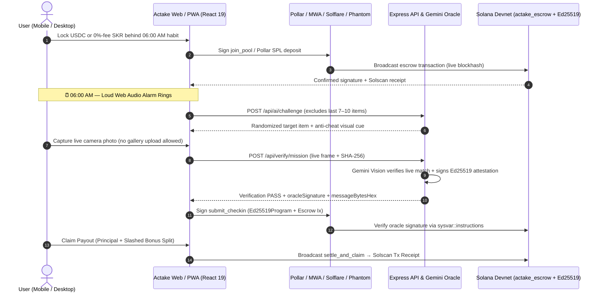

<div align="center">

<br />

<!-- Actake Brand Header -->
<h1>
  
</h1>

<h3>
  <strong>Put Real Skin in the Game. Beat the Alarm. Prove It Live. Earn From Quitters.</strong>
</h3>

<p>
  <em>A cross-platform Solana social accountability &amp; AI-verified habit staking protocol powered by Anchor Escrow, Gemini Vision Oracles, Solana Mobile MWA, and Pollar.</em>
</p>

<p>
  <a href="https://actake.vercel.app">
    
  </a>
  <a href="https://solscan.io/account/ACTKescrow111111111111111111111111111111111?cluster=devnet">
    
  </a>
  <a href="https://explorer.solana.com/address/ACTKescrow111111111111111111111111111111111?cluster=devnet">
    
  </a>
  
  
</p>

<p>
  <a href="#-pitch-deck--why-actake"><strong>Pitch Deck</strong></a> ·
  <a href="#-solana-smart-contract--solscan-verification"><strong>Smart Contract &amp; Solscan</strong></a> ·
  <a href="#-visual-tour"><strong>Visual Tour</strong></a> ·
  <a href="#-architecture--verification-loop"><strong>Architecture</strong></a> ·
  <a href="#-core-features"><strong>Core Features</strong></a> ·
  <a href="#-quick-start--deployment"><strong>Quick Start</strong></a>
</p>

</div>

---

## 🎯 Pitch Deck — Why Actake?

### 1. The Problem: Traditional Habit Trackers Are Built to Be Ignored

Every year, millions of people download habit trackers and alarm apps — and abandon them within 14 days. Why?

| Broken Mechanic | Why People Quit |
| :--- | :--- |
| **Zero Consequences** | Tapping *"Snooze"* or skipping a gym session costs $0. |
| **Honor-System Checkmarks** | Anyone can tap *"Done"* from bed while lying to themselves. |
| **Fake Photo Uploads** | Basic accountability apps let users upload old photos from their camera roll. |
| **High Crypto Friction** | Web3 accountability dApps require browser extensions, manual RPC configuration, and confusing seed phrases before a user even sets their first alarm. |

---

### 2. The Solution: Programmable Financial Commitment + Live AI Camera Proof

**Actake turns consistency into an on-chain game where showing up pays — and quitting funds the winners.**

1. **💰 Stake Real Value Behind Your Habit** — Lock **SPL USDC** or **0%-fee Token-2022 SKR** into a non-custodial Solana escrow vault behind a daily alarm cutoff (e.g., *06:00 AM Morning Wakeup*, *07:00 AM Gym*, *09:00 PM Deep Study*).
2. **🔊 Non-Dismissible Loud Alarms** — When your deadline hits, Actake triggers a persistent Web Audio alarm (`Siren`, `Klaxon`, `Chime`, or `Pulse`) that refuses to quit until you prove you are awake and active.
3. **📸 Anti-Cheat Randomized Live Camera Challenge** — No static checklists. No gallery uploads. Our Gemini Vision Oracle generates a **brand-new randomized physical target** (avoiding your last 7–10 verified items) and requires a live camera capture verified in real time.
4. **🔐 Stateless On-Chain Ed25519 Verification** — Once verified, the server signs a deterministic cryptographic Ed25519 attestation (`pool_pda || user_pubkey || day_index || proof_hash`) that is verified natively on Solana via `sysvar::instructions` introspection.
5. **🏆 Claim Principal + Slashed Bonus Splits** — Verified finishers recover 100% of their stake **plus** a proportional share of the slashed pot forfeited by participants who missed their deadline.

---

### 3. Why Users Choose Actake

<table>
  <tr>
    <td width="50%" valign="top">
      <h4>🏃 For Everyday Habit Builders</h4>
      <ul>
        <li><strong>15-Second Onboarding via Pollar</strong> — Sign in with Email, Google, or Passkey and fund USDC/SOL directly with Fiat RAMP (no extension needed).</li>
        <li><strong>1-Tap Quick Actions</strong> — Expand Quick Actions on the Today vault to deposit or launch preset stakes instantly.</li>
        <li><strong>Live USDC / SOL Valuation</strong> — Track your exact vault value in USDC or SOL with real-time 24h price fluctuation.</li>
      </ul>
    </td>
    <td width="50%" valign="top">
      <h4>📱 For Solana &amp; Seeker Mobile Users</h4>
      <ul>
        <li><strong>Native Mobile Wallet Adapter (MWA)</strong> — Seamless Android Chrome &amp; Seeker Seed Vault signing.</li>
        <li><strong>0%-Fee SKR Staking + 1.2× ACT Points</strong> — Token-2022 SKR pools waive protocol fees and boost reward multipliers.</li>
        <li><strong>Solana Actions / Blinks</strong> — Share any accountability squad as a clickable Blink so friends join directly from X/Twitter or Dialect.</li>
      </ul>
    </td>
  </tr>
</table>

---

### 4. Protocol Economics & Token Matrix

| Asset | Token Standard | Protocol Fee (on Slashed Bonus) | ACT Points Multiplier | Missed Solo Stake Routing | Missed Squad Stake Routing |
| :--- | :--- | :---: | :---: | :--- | :--- |
| **USDC** | SPL Token (6 decimals) | **1.5%** | `1.0×` | 100% to Actake Fee Treasury | Split among verified Squad winners |
| **SKR** *(Seeker)* | Token-2022 (6 decimals) | **0.0% (Fee-Free)** | `1.2×` | 100% to Actake Fee Treasury | Split among verified Squad winners |

---

## 🔗 Solana Smart Contract & Solscan Verification

Actake's on-chain escrow logic lives in [`programs/actake_escrow/programs/actake_escrow/src/lib.rs`](./programs/actake_escrow/programs/actake_escrow/src/lib.rs) (Anchor `0.30.1`, Rust). Click any link below to inspect the program, native verification contracts, or SPL token mints directly on **Solscan** or **Solana Explorer**.

### Deployed Program & On-Chain Addresses (Solana Devnet)

| Component | On-Chain Address / Program ID | Inspect on Solscan | Inspect on Solana Explorer |
| :--- | :--- | :---: | :---: |
| **Actake Escrow Contract (`actake_escrow`)** | `ACTKescrow111111111111111111111111111111111` | [](https://solscan.io/account/ACTKescrow111111111111111111111111111111111?cluster=devnet) | [](https://explorer.solana.com/address/ACTKescrow111111111111111111111111111111111?cluster=devnet) |
| **Native Ed25519 Signature Verify Program** | `Ed25519SigVerify111111111111111111111111111` | [](https://solscan.io/account/Ed25519SigVerify111111111111111111111111111?cluster=devnet) | [](https://explorer.solana.com/address/Ed25519SigVerify111111111111111111111111111?cluster=devnet) |
| **Solana Memo Program v2** *(Receipts)* | `MemoSq4gqABAXKb96qnH8TysNcWxMyWCqXgDLGmfcHr` | [](https://solscan.io/account/MemoSq4gqABAXKb96qnH8TysNcWxMyWCqXgDLGmfcHr?cluster=devnet) | [](https://explorer.solana.com/address/MemoSq4gqABAXKb96qnH8TysNcWxMyWCqXgDLGmfcHr?cluster=devnet) |
| **Devnet USDC Mint** *(SPL Token)* | `4zMMC9srt5Ri5X14GAgXhaHii3GnPAEERYPJgZJDncDU` | [](https://solscan.io/token/4zMMC9srt5Ri5X14GAgXhaHii3GnPAEERYPJgZJDncDU?cluster=devnet) | [](https://explorer.solana.com/address/4zMMC9srt5Ri5X14GAgXhaHii3GnPAEERYPJgZJDncDU?cluster=devnet) |
| **Seeker SKR Mint** *(Token-2022)* | `SKR1111111111111111111111111111111111111111` | [](https://solscan.io/token/SKR1111111111111111111111111111111111111111?cluster=devnet) | [](https://explorer.solana.com/address/SKR1111111111111111111111111111111111111111?cluster=devnet) |

> **💡 Custom Deployment Tip:** When you deploy your own instance of `programs/actake_escrow` via `anchor deploy --provider.cluster devnet`, set `VITE_ACTAKE_ESCROW_PROGRAM_ID=<YOUR_DEPLOYED_PROGRAM_ID>` in your environment variables. Actake automatically derives real PDAs and routes all Solscan & Solana Explorer transaction links to your deployed program. See [`programs/actake_escrow/DEPLOY_DEVNET.md`](./programs/actake_escrow/DEPLOY_DEVNET.md) for the 4-step deployment guide.

### Smart Contract Instructions (`actake_escrow`)

| Instruction | Access | Description |
| :--- | :--- | :--- |
| `create_pool` | Pool Creator | Initializes a commitment Pool PDA + Token Vault PDA supporting both SPL Token (`USDC`) and Token-2022 (`SKR`), configured with `oracle_pubkey`, `treasury`, `stake_amount`, `deadline_unix_ts`, and `protocol_fee_bps`. |
| `join_pool` | Any User | Locks the user's SPL/Token-2022 stake into the Pool Vault PDA via `transfer_checked` and initializes their Participant PDA with a 64-day check-in bitmap. |
| `submit_checkin` | Verified User | Uses Solana `sysvar::instructions` introspection to verify that the immediately preceding instruction is a valid native `Ed25519Program` attestation signed by `pool.oracle_pubkey` over `pool_pda \|\| user_pubkey \|\| day_index \|\| proof_hash`. |
| `settle_and_claim` | Verified Winner | Transfers the winner's principal + proportional slashed bonus directly from the Vault PDA and routes the protocol fee (1.5% USDC / 0% SKR) to the constrained `treasury_token_account`. |
| `sweep_to_treasury` | Permissionless *(Post-Deadline)* | Sweeps 100% of forfeited stakes from expired solo commitments or zero-winner pools directly from the Vault PDA into the Actake Fee Treasury. |

### Deterministic PDA Seeds & Oracle Message Layout

```text
Pool PDA:         ["pool", pool_id_16_bytes]
Vault PDA:        ["vault", pool_pda]
Participant PDA:  ["participant", pool_pda, user_pubkey]

Oracle Ed25519 Attestation Payload (98 bytes):
┌──────────────────┬──────────────────┬────────────────────┬────────────────────┐
│ pool_pda (32 B)  │ user_pubkey (32) │ day_index (2 B LE) │ proof_hash (32 B)  │
└──────────────────┴──────────────────┴────────────────────┴────────────────────┘
```

---

## 🖼️ Visual Tour

<div align="center">
  <table>
    <tr>
      <td align="center" width="25%">
        
        <br />
        <strong>Today Vault &amp; Live Balances</strong>
        <br />
        <sub>USDC/SOL toggle, 24h fluctuation &amp; 1-tap Quick Actions</sub>
      </td>
      <td align="center" width="25%">
        
        <br />
        <strong>Morning Consistency</strong>
        <br />
        <sub>06:00 AM cutoff stakes with non-dismissible alarms</sub>
      </td>
      <td align="center" width="25%">
        
        <br />
        <strong>Live AI Camera Proof</strong>
        <br />
        <sub>Randomized daily object verification — zero fake uploads</sub>
      </td>
      <td align="center" width="25%">
        
        <br />
        <strong>Streak Escrow &amp; Payouts</strong>
        <br />
        <sub>Claim principal + slashed bonus splits on-chain</sub>
      </td>
    </tr>
  </table>
</div>

### Ecosystem & Wallet Partners

<div align="center">
  <table>
    <tr>
      <td align="center" width="20%">
        
        <br />
        <strong>Pollar</strong><br />
        <sub>Email, Passkey &amp; Fiat RAMP</sub>
      </td>
      <td align="center" width="20%">
        
        <br />
        <strong>Solana &amp; MWA</strong><br />
        <sub>Seeker Seed Vault &amp; SPL</sub>
      </td>
      <td align="center" width="20%">
        
        <br />
        <strong>Anchor Escrow</strong><br />
        <sub>PDA Vaults &amp; Ed25519</sub>
      </td>
      <td align="center" width="20%">
        
        <br />
        <strong>Gemini Oracle</strong><br />
        <sub>Live Anti-Cheat Vision</sub>
      </td>
      <td align="center" width="20%">
        
        <br />
        <strong>Supabase</strong><br />
        <sub>Squad Pools &amp; Live Feeds</sub>
      </td>
    </tr>
  </table>
</div>

---

## 🏗️ Architecture & Verification Loop



---

## ✨ Core Features

- **🔐 Unified Cross-Platform Auth (Mobile Full-Screen + Desktop Pop-Up)**
  - **Pollar Account** *(Recommended)* — Email, Google, Passkey sign-in + integrated Fiat RAMP & QR deposits.
  - **Solana Mobile Wallet Adapter (MWA)** — Native Android Chrome & Seeker Seed Vault intents.
  - **Wallet Standard Extensions** — Automatic discovery & seamless reload reconnection for Solflare, Phantom, and Backpack.
  - **Browser Devnet Vault** — Instant local Ed25519 keypair so anyone can test alarms and camera verification in 1 tap.
- **💳 Live Today Vault Dashboard**
  - Displays combined **Total Vault Balance** with a 1-tap **USDC / SOL toggle** powered by live SOL/USD market pricing and **24h price fluctuation** (`+ / - %`).
  - **Collapsible Quick Actions Row** (collapsed by default) to instantly deposit USDC or lock preset stakes (*Morning Wakeup $10 USDC*, *Gym & Fitness $25 USDC*, *Study Session 25 SKR*).
- **⏰ Non-Dismissible Alarms & AI Live Camera Verification**
  - Background foreground clock watcher triggers Web Audio alarms (`Siren`, `Klaxon`, `Chime`, `Pulse`) at the exact scheduled minute.
  - Live `getUserMedia` camera stream with randomized Gemini challenge targets and SHA-256 photo hashing.
- **🧾 Expanded Transaction Details Modal (`HistoryView`)**
  - Click any historical stake or payout to inspect **real-time on-chain confirmation status** (`finalized` / `confirmed`), slot number, block time, **network fee breakdowns (SOL + USD)**, protocol fee details, and one-click **Solscan** & **Solana Explorer** links.
- **👥 Squad Pools, Live Social Feed & Solana Blinks**
  - Create or join community accountability pools with reactions, real-time member check-in feeds, and shareable **Solana Actions / Blinks** (`/actions.json` + `/api/actions/join/:poolId`).
- **📍 GPS Geo-Hunts**
  - Location-gated physical challenges combining browser geolocation proximity checks with live AI camera verification.

---

## 🧰 Tech Stack

| Layer | Technologies |
| :--- | :--- |
| **Frontend** |      |
| **Solana & Wallets** | `@solana/web3.js`, `@solana-mobile/wallet-standard-mobile`, `@wallet-standard/app`, `@pollar/react`, `@pollar/core`, `bs58`, Anchor `0.30.1` (Rust) |
| **Backend & AI Oracle** |   `@google/genai` (Gemini Vision + Challenge Oracle), Node `crypto` Ed25519 signing |
| **Database & Hosting** |   |

---

## 🚀 Quick Start & Deployment

### 1. Clone & Install Dependencies

```bash
git clone <your-repo-url>
cd actake
npm install
```

### 2. Configure Environment Variables

Copy `.env.example` to `.env` (or configure in **Vercel → Project Settings → Environment Variables**):

| Variable | Scope | Required | Purpose |
| :--- | :---: | :---: | :--- |
| `GEMINI_API_KEY` | Server | **Yes** | Powers randomized verification challenges & live camera vision verification. |
| `VITE_POLLAR_API_KEY` | Client | **Recommended** | Publishable Pollar key (add your domain to Allowed Origins in Pollar Dashboard). |
| `ACTAKE_ESCROW_WALLET` / `VITE_ACTAKE_ESCROW_WALLET` | Server + Client | **Recommended** | Public Solana address holding active USDC/SKR stakes before custom Anchor deploy. |
| `ACTAKE_TREASURY_WALLET` / `VITE_ACTAKE_TREASURY_WALLET` | Server + Client | **Recommended** | Public Solana address receiving 1.5% USDC fees & 100% solo forfeits. |
| `VITE_ACTAKE_ESCROW_PROGRAM_ID` | Client | Optional | Deployed Solana Devnet Anchor Program ID (defaults to `ACTKescrow111111111111111111111111111111111`). |
| `SOLANA_RPC_URL` | Server | Optional | Dedicated Solana RPC endpoint (defaults to `https://api.devnet.solana.com`). |
| `ORACLE_PRIVATE_KEY_HEX` | Server | Optional | Persistent 64-char hex Ed25519 seed for deterministic on-chain attestations. |
| `SUPABASE_URL` & `SUPABASE_SERVICE_ROLE_KEY` | Server | Optional | Persistent PostgreSQL storage for pools, participants & check-ins (`supabase/schema.sql`). |
| `APP_URL` | Server | Optional | Production origin (e.g. `https://actake.vercel.app`) for Solana Blinks & invite links. |

### 3. Run Locally

```bash
npm run dev
```

The unified Express + Vite server runs on **`http://localhost:3000`**.

### 4. Build & Type-Check

```bash
npm run lint
npm run build
```

### 5. Deploy the Anchor Escrow Smart Contract to Solana Devnet

```bash
cd programs/actake_escrow
solana config set --url devnet
solana airdrop 2
anchor build
anchor keys list
# Paste the generated Program ID into Anchor.toml & src/lib.rs, then rebuild:
anchor build
anchor deploy --provider.cluster devnet
```

Then inspect your live contract on Solscan:
```text
https://solscan.io/account/<YOUR_DEPLOYED_PROGRAM_ID>?cluster=devnet
```

---

## 📡 Backend API Reference

| Method | Endpoint | Description |
| :---: | :--- | :--- |
| `GET` | `/api/health` | Server health check & uptime status. |
| `GET` | `/actions.json` | Solana Actions / Blinks discovery manifest. |
| `GET / POST` | `/api/actions/join/:poolId` | Live Solana Blink metadata & transaction builder for joining a squad pool. |
| `POST` | `/api/ai/challenge` | Generates a randomized physical verification prompt excluding recent items. |
| `POST` | `/api/verify/mission` | Verifies live camera frame via Gemini Vision & returns an Ed25519 oracle attestation. |
| `GET` | `/api/solana/price` | Live SOL/USD spot price & 24h percentage fluctuation. |
| `GET` | `/api/solana/tx/:signature` | Real-time Solana Devnet confirmation status, slot, fee breakdown & explorer links. |
| `POST` | `/api/solana/rpc` | Server-side CORS-free Solana Devnet JSON-RPC proxy. |
| `POST` | `/api/solana/send-tx` | Broadcasts signed transactions to Solana Devnet & confirms signature status. |
| `POST` | `/api/solana/airdrop` | Requests a Devnet SOL gas airdrop for testing wallets. |
| `GET / POST` | `/api/pools` | Lists or creates personal & squad accountability pools. |
| `POST` | `/api/pools/:poolId/settle` | Computes & records winner payout splits (0% fee SKR / 1.5% USDC). |
| `POST` | `/api/pools/:poolId/slash` | Settles forfeited solo stakes directly to the Actake Fee Treasury. |
| `GET` | `/api/treasury/summary` | Returns configured escrow/treasury wallets and fee summary. |
| `GET` | `/api/system/readiness` | Live diagnostics for RPC, Gemini Oracle public key, Pollar, and Supabase. |

---

## 📁 Project Structure

```text
actake/
├── programs/actake_escrow/        # Anchor 0.30.1 Rust smart contract + Devnet deploy guide
│   ├── Anchor.toml
│   ├── DEPLOY_DEVNET.md
│   └── programs/actake_escrow/src/lib.rs
├── src/
│   ├── components/                # AuthPage, HomeView, MissionsView, HistoryView, LiveCameraVerifyView...
│   ├── context/                   # ActakePollarProvider (Pollar SDK bridge)
│   ├── solana/                    # actakeEscrow.ts, walletManager.ts, pollarBridge.ts, registerMwa.ts
│   ├── data/                      # Local store & built-in habit categories
│   ├── utils/                     # Web Audio alarm engine, safeFetchJson, time utilities
│   └── assets/images/             # Editorial consistency & UI imagery
├── supabase/                      # PostgreSQL schema for pools, participants & check-ins
├── server.ts                      # Express API, Gemini Vision Oracle, Solana RPC proxy & Blinks
└── api/                           # Vercel serverless API entrypoint
```

---

<div align="center">
  <br />
  <strong>Built with ❤️ on Solana Mobile &amp; Anchor</strong>
  <br />
  <a href="https://solscan.io/account/ACTKescrow111111111111111111111111111111111?cluster=devnet">Inspect Actake Escrow Program on Solscan ↗</a>
  <br /><br />
</div>
